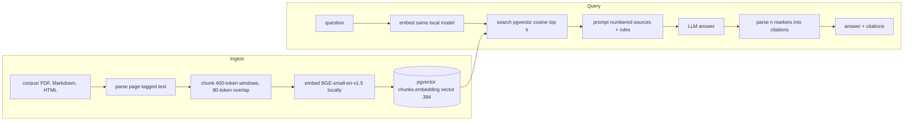

# Architecture

Two flows share one local embedding model and one Postgres table. Ingest writes page-tagged
chunks into pgvector; a query embeds the question, retrieves the nearest chunks, asks the LLM (Ollama Cloud by default, Anthropic Claude optional)
to answer from those chunks only, and maps the `[n]` markers back to sources.

## Ingest path

1. **Parse.** `ragchat/ingest/parsers.py` turns each supported file (`.pdf`, `.md`, `.html`,
   `.htm`) into page-tagged text. PDF page numbers come from the PDF; Markdown sections and
   HTML `h1` sections become page-like units.
2. **Chunk.** `ragchat/ingest/chunker.py` cuts fixed token windows (400 tokens, 80 overlap)
   inside a single page, so no chunk crosses a page boundary and citations stay precise.
3. **Embed.** `ragchat/embeddings.py` runs `BAAI/bge-small-en-v1.5` through fastembed's local
   ONNX runtime and returns 384-dimensional vectors.
4. **Store.** `ragchat/store.py` writes `doc_id`, `file`, `page`, `chunk_index`, `text`,
   `tokens` and the vector into the `chunks` table. `replace_doc` deletes the document's old
   rows first, so re-ingesting is idempotent. An HNSW index on cosine distance backs search.

## Query path

1. **Embed.** The question goes through the same local embedder as ingest, so query and
   document vectors share one space.
2. **Search.** `Store.search` orders by cosine distance (`<=>`) and returns the top `k`
   chunks (`RAG_TOP_K`, default 5; the request may override it up to 10). When reranking is
   enabled, the search instead fetches `RAG_RERANK_CANDIDATES` chunks (default 15). With
   `RAG_HYBRID` on, one SQL statement also ranks chunks by Postgres full-text search
   (`plainto_tsquery` OR-ed over the question's lexemes, scored with `ts_rank_cd`) and fuses
   the two ranked lists with reciprocal rank fusion (k=60). An empty keyword query, such as
   one made only of stopwords, still returns the vector results.
3. **Rerank (optional).** With `RAG_RERANK` on, `ragchat/rerank.py` scores each
   query-passage pair with a local cross-encoder (`RAG_RERANK_MODEL`, default
   `Xenova/ms-marco-MiniLM-L-12-v2`) and keeps the highest-scoring `k` chunks. The model loads
   lazily on the first reranked request, so the default path avoids the download.
4. **Prompt.** `ragchat/answer.py` numbers the retrieved chunks `[1]..[n]` and sends them,
   plus the question, with a system prompt that allows only those sources and requires a
   citation for every factual claim.
5. **Answer.** The LLM returns text (`ragchat/llm.py` picks Ollama Cloud or Anthropic from `LLM_PROVIDER`). If retrieval found no chunks, the code returns the refusal
   immediately instead of calling the model.
6. **Citation parse.** `parse_citations` scans the answer for `[n]` markers and keeps only
   in-range, distinct numbers. Each surviving marker becomes a citation containing the
   source file, page and a snippet.

## Why the embedder is local

`fastembed` downloads the BGE model once and then runs on the machine. Query embedding needs
no API key and no network after that first download, which keeps retrieval cheap and fast,
makes tests hermetic, and leaves the LLM key for answer generation only.

## Why citations are parsed from `[n]`

The model is asked to cite with `[n]` because the markers are simple to render and easy to
check against the supplied sources. Parsing is deliberately forgiving: a malformed,
duplicated or out-of-range marker is ignored, so the answer is still returned with fewer
citations (or none) rather than failing the request. The UI only turns a marker into a
clickable citation when the parsed citations contain that number. A malformed marker
therefore degrades to an uncited claim, not an error.

## Two key lanes

- **Self-host (own key).** Run locally or in Docker with your own `OLLAMA_API_KEY` (or `ANTHROPIC_API_KEY` with `LLM_PROVIDER=anthropic`).
  Rate limiting is off by default (`RATE_LIMIT_ENABLED=0`).
- **Hosted demo (owner key).** The owner's key lives in the server environment and is never
  sent to the browser. The demo sets `RATE_LIMIT_ENABLED=1`, backed by Upstash Redis, with a
  per-IP hourly limit (`PER_IP_PER_HOUR`) and a daily cap (`DAILY_CAP`).

## Not implemented

- OCR for scanned PDFs
- Multi-tenancy (the database holds one corpus)
- An upload endpoint (documents are ingested from `corpus/` on the command line)
- Streaming responses (answers arrive in one JSON response)
